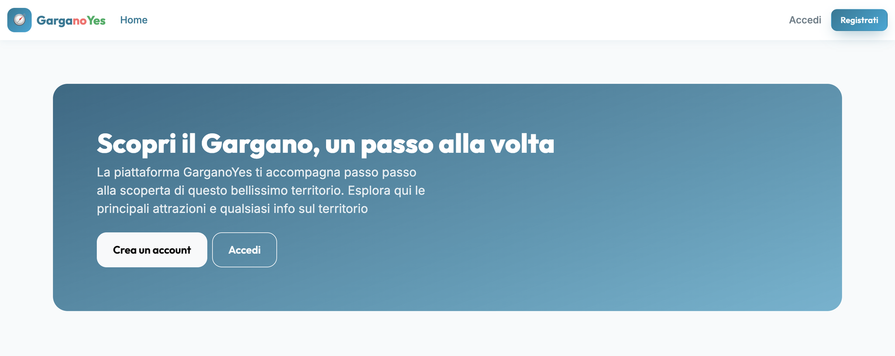

# GarganoYes
[](https://github.com/biagiocota24/garganoExplorer/actions/workflows/ci.yml)

A full-stack web platform to discover the Gargano area in southern Italy: beaches, villages, trails and places to stay, told by people who live there.

**Live demo:** [garganoyes.it](https://garganoyes.it)

> The backend runs on a free hosting plan and goes to sleep after a period of inactivity. The first request after a pause can take up to a minute; after that, the app responds normally.



---

## Features

### Available now
- **Registration and login** with visitor or owner accounts
- **Session handled with a JWT in an httpOnly cookie** (the token is never exposed to JavaScript)
- **Protected pages** and a profile page for the logged-in user
- **Role-based accounts** (`VISITOR`, `OWNER`, `ADMIN`); administrators cannot be created through the public API
- **Field-level validation errors** returned by the backend and shown under each form field
- **Responsive UI** for desktop and mobile

### Roadmap
- [ ] Places and accommodations: listing, detail pages, management for owners
- [ ] Photo uploads
- [ ] Reviews and favourites
- [ ] Interactive map (Leaflet)

---

## Tech stack

| Area | Technologies |
|---|---|
| **Backend** | Java 21, Spring Boot 4, Spring Security, Spring Data JPA, Bean Validation, jjwt |
| **Database** | PostgreSQL 17 |
| **Frontend** | React, TypeScript, Vite, React Router 7, Zustand, React-Bootstrap |
| **Testing** | JUnit 5, Mockito, AssertJ, MockMvc, Testcontainers |
| **DevOps** | Docker, GitHub Actions, Render (backend), Vercel (frontend), Neon (database) |

---

## Architecture

```
            garganoyes.it                     api.garganoyes.it
   ┌─────────────────────────┐         ┌──────────────────────────┐
   │  React SPA (Vercel)     │  HTTPS  │  Spring Boot API         │
   │  React Router, Zustand  │ ──────► │  (Docker on Render)      │
   └─────────────────────────┘ cookie  └────────────┬─────────────┘
                                                     │ JDBC / TLS
                                        ┌────────────▼─────────────┐
                                        │  PostgreSQL 17 (Neon)    │
                                        └──────────────────────────┘
```

The backend is organised **by feature** (`auth`, `user`, `security`, `common`) rather than by technical layer, so each feature keeps its controller, service, DTOs and exceptions together.

### Security choices

- **JWT in an httpOnly, Secure, SameSite=Lax cookie.** The token cannot be read by JavaScript, so it cannot be stolen through an XSS attack, unlike a token stored in `localStorage`.
- **Same site, two origins.** Frontend and backend live on two subdomains of the same domain. The cookie stays first-party (it works in Safari too) and `SameSite=Lax` protects against CSRF. Cross-origin requests are allowed only for the configured frontend origin (CORS with credentials).
- **User loaded on every request.** The token only contains the user id; roles are read from the database, so role changes take effect immediately.
- **No admin creation through the API.** The public registration endpoint only accepts `VISITOR` and `OWNER`. The first administrator is created at startup from environment variables.
- **Same error for unknown email and wrong password**, with a dummy BCrypt check to reduce timing differences between the two cases.
- **Consistent error responses** in the `ProblemDetail` format (RFC 9457).
- **Secrets only in environment variables**, never in the repository.

### Known limitations
- Tokens stay valid until they expire after logout (stateless JWT, no revocation list).
- No automated frontend tests yet.

---

## API overview

| Method | Endpoint | Auth | Description |
|---|---|---|---|
| `POST` | `/api/auth/register` | Public | Create a visitor or owner account |
| `POST` | `/api/auth/login` | Public | Log in and receive the session cookie |
| `POST` | `/api/auth/logout` | Public | Clear the session cookie |
| `GET` | `/api/users/me` | Required | Return the current user |

---

## Running locally

### Requirements
- Java 21
- Node.js (LTS)
- Docker

### 1. Environment variables
Copy `.env.example` to `.env` in the project root and fill in the values:

```
DB_NAME=garganoexplorer
DB_USERNAME=garganoexplorer
DB_PASSWORD=change-me
DB_PORT=5433
JWT_SECRET=a-random-string-of-at-least-64-characters
COOKIE_SECURE=false
ADMIN_EMAIL=
ADMIN_PASSWORD=
```

`ADMIN_EMAIL` and `ADMIN_PASSWORD` are optional: if set, an administrator account is created at the first startup.

### 2. Database
```bash
docker compose up -d
```

### 3. Backend
```bash
cd backend
./mvnw spring-boot:run
```
The API is available at `http://localhost:8080`.

### 4. Frontend
```bash
cd frontend
npm install
npm run dev
```
The app is available at `http://localhost:5173`. In development, Vite proxies `/api` requests to the backend.

### Tests
```bash
cd backend
./mvnw verify
```
The integration test starts a disposable PostgreSQL container with Testcontainers, so Docker must be running.

---

## Production environment variables

| Service | Variable | Purpose |
|---|---|---|
| Backend | `DB_URL`, `DB_USERNAME`, `DB_PASSWORD` | Database connection |
| Backend | `JWT_SECRET` | Token signing key |
| Backend | `COOKIE_SECURE`, `COOKIE_SAME_SITE` | Cookie settings |
| Backend | `CORS_ALLOWED_ORIGINS` | Allowed frontend origins |
| Backend | `ADMIN_EMAIL`, `ADMIN_PASSWORD` | First administrator |
| Frontend | `VITE_API_URL` | Public URL of the backend |

---

## Author

**Biagio Cota** — Junior Full-Stack Developer

[LinkedIn](https://www.linkedin.com/in/biagiocota24) · [GitHub](https://github.com/biagiocota24)

## License

This project is released under the [MIT License](LICENSE).
